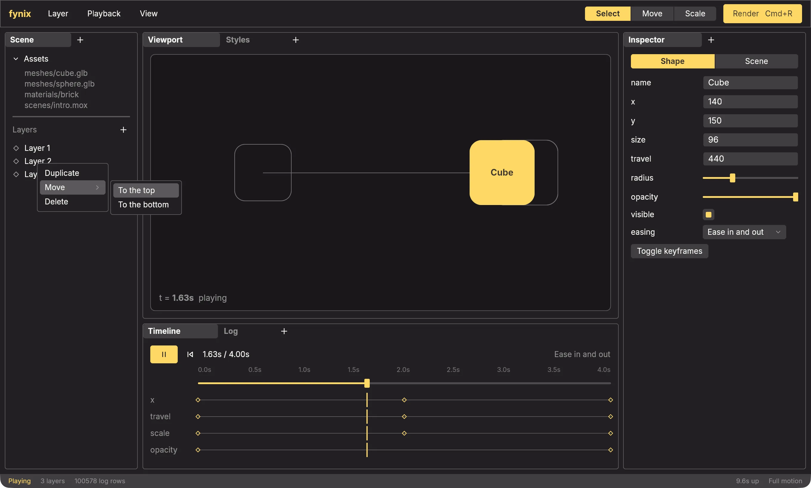

# Bevy Fynix

[](https://github.com/voxell-tech/fynix#license)
[](https://crates.io/crates/bevy_fynix)
[](https://crates.io/crates/bevy_fynix)
[](https://docs.rs/bevy_fynix/latest/bevy_fynix/)
[](https://github.com/voxell-tech/fynix/actions)
[](https://discord.gg/Mhnyp6VYEQ)

**Bevy Fynix** is the Bevy backend for [`fynix`](https://crates.io/crates/fynix).

Nodes are entities and the world is Bevy's `World`. On top of that,
it ships views written against `bevy_ui`, the token traits they read,
and the states their rules wait on.



An app inserts its theme as a `Theme<T>` resource, adds
`FynixPlugin<T>`, and calls `mount` to build a view at the root of
the UI. From then on the plugin keeps every mounted view in step with
the world, and a system that reads what the views built runs after
`FynixSystems::Mount`.

The pointer and focus states are `fynix_interact`'s, waited on with
`.when_in::<Hovered, _>(..)`, and a component of your own is a state
too: `.when::<S, _>(..)`. A view that a
`keyed` or `each` with a presence builds or drops is `Entering` or
`Leaving` while it animates, and `ReducedMotion` skips the animation.

## Quick Start

See [`showcase`](examples/showcase) for a whole app, a small motion
editor in docked panels, or run
`cargo run -p bevy_fynix --example showcase` to try it.

```rust
use std::time::Duration;
use bevy::color::Color;
use bevy::ecs::world::World;
use bevy_fynix::views::{
    FrameProps, Label, button, column, label,
};
use bevy_fynix::tokens::{
    Curve, MotionTokens, SpacingTokens, SurfaceTokens,
    TextTokens, Tone,
};
use bevy_fynix::{Bevy, Cx, ScopedExt, mount};
use fynix_interact::Hovered;

struct MyTheme;

impl TextTokens for MyTheme {
    fn tone(&self, _: Tone) -> Color {
        Color::WHITE
    }
    fn body_size(&self) -> f32 {
        14.0
    }
    fn small_size(&self) -> f32 {
        11.0
    }
}

impl SurfaceTokens for MyTheme {
    fn fill(&self) -> Color {
        Color::BLACK
    }
    fn hover(&self) -> Color {
        Color::BLACK
    }
    fn panel(&self) -> Color {
        Color::BLACK
    }
    fn accent(&self) -> Color {
        Color::WHITE
    }
}

impl SpacingTokens for MyTheme {
    fn gap(&self) -> f32 {
        8.0
    }
    fn row(&self) -> f32 {
        24.0
    }
    fn radius(&self) -> f32 {
        4.0
    }
}

impl MotionTokens for MyTheme {
    fn interact(&self) -> Curve {
        Curve {
            duration: Duration::from_millis(180),
            ease: |t| t,
        }
    }

    fn expand(&self) -> Curve {
        Curve {
            duration: Duration::from_millis(280),
            ease: |t| t,
        }
    }
}

fn setup(world: &mut World) {
    mount::<MyTheme>(
        world,
        column((
            label("Settings").size(20.0),
            button(label("Save"))
                // Every label in the button turns accent on hover.
                .when_in::<Hovered, _>(|cx: &mut Cx<Bevy, MyTheme>| {
                    cx.set::<Label>(|l, _| l.tone(Tone::Accent));
                })
                .transition(MyTheme::interact),
        ))
        .gap(8.0),
    );
}
```

## Styling

Three things decide how a view looks, and they stay apart:

- **Theming** says what the colours, sizes and curves of an app are.
  A theme implements the token traits its views read. Views and
  styles ask for a role (`Tone::Dim`, `theme.hover()`), never a raw
  colour, so changing the theme restyles everything.
- **Styling** says which looks a view comes in: ghost, icon, primary.
  A look is a rule bundle, applied with `.rules(..)`. It is made of
  set rules, which restyle every `Frame`, `Label` or `Icon` built
  under it, with `cx.root(..)` keeping a rule to the view's root.
- **State rules** say what a look does while the pointer is on the
  view, while a button is down on it, or while any component of your
  own is on it: `.when_in::<Hovered, _>(..)`,
  `.when_in::<Pressed, _>(..)`, `.when::<S, _>(..)`.
  `.transition(T::interact)` makes the change glide over a curve the
  theme picks. A transition never makes a view grow in or out:
  only `keyed(..).presence(T::expand)` or `each(..).presence(..)`
  does.

Buttons ship with their looks as bundles. Each sets a resting, a
hovered and a pressed look from the theme, and glides between them:

```rust,ignore
button(label("Cancel")).rules(ghost);
button(icon(save)).rules(icon_button);
button(label("Save")).rules(primary);
button(label("Delete")).rules(danger);
button(row((icon(tag), label("Tag")))).rules(tint);
```

For a look of your own, build a `Style` rather than writing `cx.set`
closures. It takes colours as closures over the theme, and a nested
look for each state:

```rust,ignore
let chunky = style::<MyTheme>()
    .fill(|t| t.panel())
    .frame(|f, t| f.radius(t.radius() * 3.0))
    .hovered(|s| s.fill(|t| t.fill()).tone(Tone::Accent))
    .pressed(|s| s.fill(|t| t.pressed()).tone(Tone::Critical))
    .transition(MyTheme::interact);

button(label("Custom")).rules(chunky.bundle());
```

`fill` and `frame` reach the root frame alone, `tone` reaches every
label, rich text and icon in the view, and `label` and `icon` reach
every label or icon. Later steps win, and a press shows its hover
look unless `pressed` says otherwise. Styles
join with `then`, and `with(ghost)` starts from a bundle. Chained
`.rules(a).rules(b)` also works, but as set rules go the inner `a` wins
over `b` for resting looks, while for state looks the outer `b` wins.
Use `then` when the order matters.

## Version Matrix

| Bevy    | Fynix          | Bevy Fynix     |
| ------- | -------------- | -------------- |
| 0.20    | 0.0.3 - 0.0.4  | 0.0.3 - 0.0.4  |
| 0.19    | 0.0.1 - 0.0.2  | 0.0.1 - 0.0.2  |

## Join the community!

You can join us on the [Voxell discord server](https://discord.gg/Mhnyp6VYEQ).

## License

`bevy_fynix` is dual-licensed under either:

- MIT License ([LICENSE-MIT](../../LICENSE-MIT) or [http://opensource.org/licenses/MIT](http://opensource.org/licenses/MIT))
- Apache License, Version 2.0 ([LICENSE-APACHE](../../LICENSE-APACHE) or [http://www.apache.org/licenses/LICENSE-2.0](http://www.apache.org/licenses/LICENSE-2.0))

This means you can select the license you prefer!
This dual-licensing approach is the de-facto standard in the Rust ecosystem and there are [very good reasons](https://github.com/bevyengine/bevy/issues/2373) to include both.
